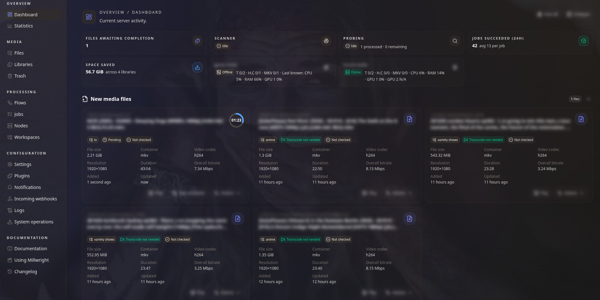
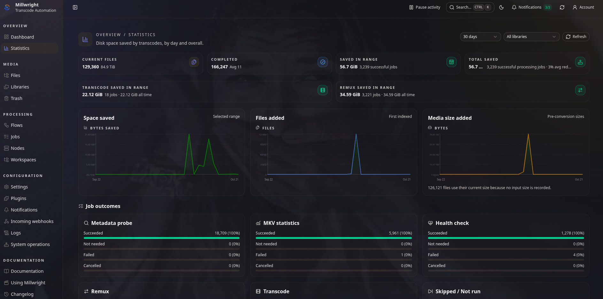
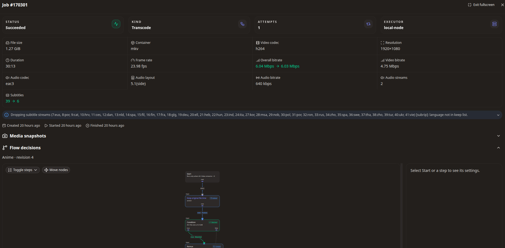

# Millwright

Millwright is a self-hosted automation interface for [FFmpeg](https://ffmpeg.org/). It can be used to automate
media processing tasks, such as changing video codecs, containers, audio tracks, and subtitles. You can process 
individual files or let Millwright handle new files automatically.

> [!WARNING]
> Millwright is still in alpha phase and may have bugs or incomplete features.

### If you like my work, you might also like my other projects:

* [YTPTube](https://github.com/arabcoders/ytptube): Media download manager, automation interface, and media library preparation layer for yt-dlp.
* [WatchState](https://github.com/arabcoders/watchstate): Self-hosted service to sync your media servers without relying on 3rd-party external services.

## Screenshots

Dashboard:



Statistics:



Job details:



## How it works

1. Add your media folders as a **Library**.
2. Choose a **Flow** that describes which files to process and what to change.
3. Preview the flow to see which files match.
4. A **Node** runs the conversion. Millwright checks the result before replacing the library file.

You can add nodes on other machines to share the conversion work.

> [!WARNING]
> Millwright can replace your media files. Keep originals in Trash while trying a new flow, and maintain
> a separate backup of media you can't replace.

## What you can do

- Convert video with software or hardware encoders.
- Remux MKV and MP4 files, convert selected audio tracks, and filter tracks by language.
- Extract subtitles, burn subtitles into video, and embed metadata from NFO or yt-dlp sidecars.
- Use conditions to apply different processing to different files.
- Schedule processing, wait for new files to finish copying, and pause work without cancelling active jobs.
- Play media in the browser and inspect conversion logs, progress, and before-and-after media details.
- Restore retained originals and track disk space saved.
- Receive import notifications from Sonarr or Radarr and notify them after a conversion.

See [Using Millwright](docs/usage.md) for the workflow and [Flow recipes](docs/recipes.md) for examples.

## Install

Run the installer in your chosen installation directory and enter your media folder when prompted:

```bash
bash <(curl -fsSL https://raw.githubusercontent.com/arabcoders/millwright/dev/install.sh)
```

See the [installation guide](docs/installation.md) for requirements, storage, GPU access, and remote nodes.

After starting Millwright, open `http://<server-ip>:8000`, create your account, and [add your first library](docs/usage.md#add-a-library).

## Security

> [!IMPORTANT]
> All accounts and API key holders have administrator access and can replace library files.
> Only give access to people you trust.

Use HTTPS for network access and install plugins only from trusted sources. Read the
[security policy](SECURITY.md) before exposing an instance and use
[private vulnerability reporting](https://github.com/arabcoders/millwright/security/advisories/new)
to report security problems.

## Documentation

Please see - [Documentation index](docs/README.md).

## Project Policy

Millwright is a personal-first project. Contributions are welcome ONLY after approval from the maintainer following 
prior discussion. Any unsolicited pull requests will be declined. Read [CONTRIBUTING](CONTRIBUTING.md) before starting 
any work to avoid wasting your and the maintainer's time.

AI-assisted tools have been used in this project and will continue to be used where I find them useful. This project is 
built for my own needs and use cases, and I maintain it according to my own preferences.

You're welcome to use it if it works for you, but I won't change the project's development approach. If the use of 
AI-assisted tools is a deal-breaker for you, this project may not be the right fit for you. Feel free to build your own.

## Community

For short questions, join the [Discord server](https://discord.gg/G3GpVR8xpb). Millwright is maintained as a solo 
project, so replies may take some time.

If you want to support the work financially, please donate to a children's charity such as 
[Make-A-Wish](https://worldwish.org) international instead.
