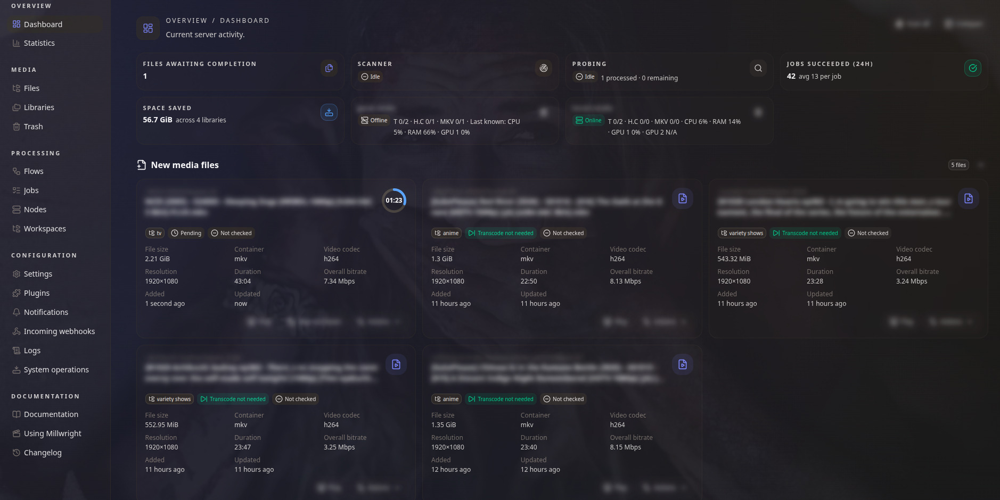
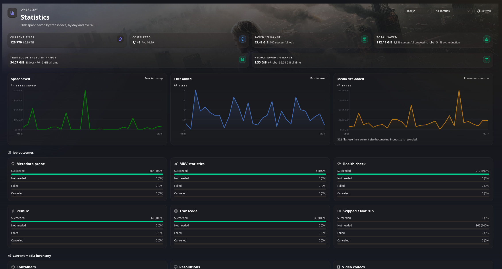
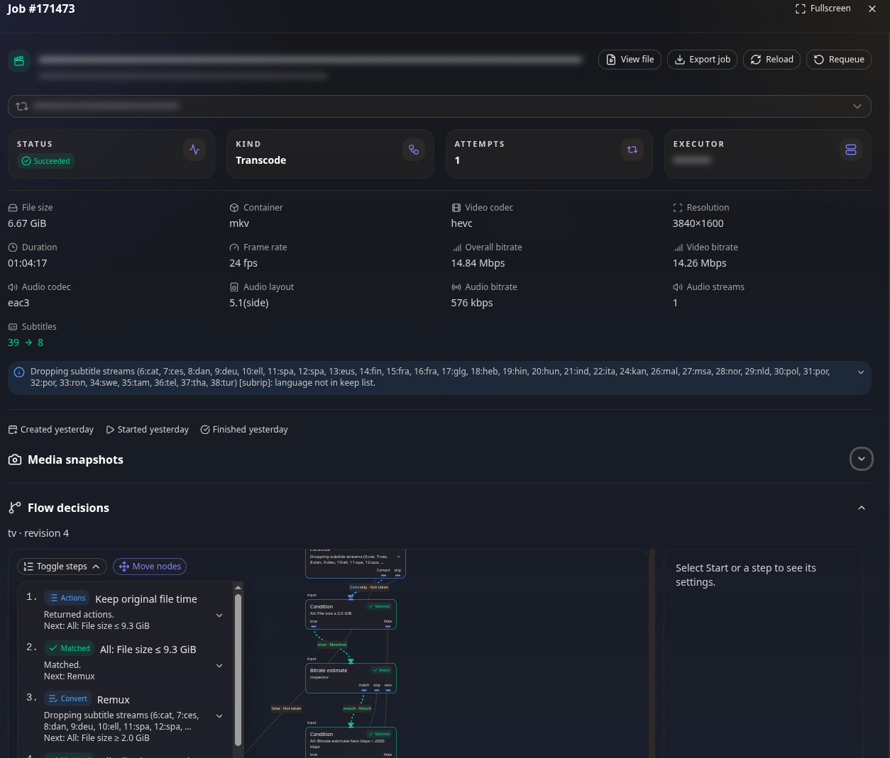

# Millwright

Millwright is a self-hosted [FFmpeg](https://ffmpeg.org/) automation tool. Convert individual files or
apply rules to a library to change codecs, containers, audio tracks, and subtitles.

> [!WARNING]
> Millwright is in beta. I've tested NVIDIA, Intel QSV, and software encoders on my own library.
> I haven't tested AMD encoders.

### If you like my work, you might also like my other projects:

* [YTPTube](https://github.com/arabcoders/ytptube): Media download manager, automation interface, and media library preparation layer for yt-dlp.
* [WatchState](https://github.com/arabcoders/watchstate): Self-hosted service to sync your media servers without relying on 3rd-party external services.

## Screenshots

Dashboard:

Statistics:

Job details:

## How it works

Add a **Library** and preview a **Flow** to see which files it would change. **Nodes** run conversions
on the server or on other machines. Millwright checks the output before replacing the original.

> [!WARNING]
> [Keep originals in Trash](docs/recovery.md#retain-originals) while trying a new flow. Keep a separate
> backup of media you can't replace.

## What you can do

- Convert video with software or hardware encoders.
- Remux MKV and MP4 files, convert selected audio tracks, and filter tracks by language.
- Extract subtitles, burn subtitles into video, and embed metadata from NFO or yt-dlp sidecars.
- Use conditions to apply different processing to different files.
- Schedule processing, wait for new files to finish copying, and pause work without cancelling active jobs.
- Play media in the browser and inspect conversion logs, progress, and before-and-after media details.
- Restore retained originals and track disk space saved.
- Receive import notifications from Sonarr or Radarr and notify them after a conversion.

## Install

Follow the [installation guide](docs/installation.md) to run the installer, claim a node, and add
your first library. See the [documentation index](docs/README.md) for setup guides and references.

## Security

> [!IMPORTANT]
> Every account and API key holder can replace library files. See the [security policy](SECURITY.md)
> before giving others access.

## Project Policy

Millwright is built for my own use. Get approval before starting a contribution. Unsolicited pull
requests will be declined. See [Contributing](CONTRIBUTING.md).

I use AI-assisted tools when I find them useful and don't plan to change that.

## Community

For short questions, join the [Discord server](https://discord.gg/G3GpVR8xpb). Millwright is maintained as a solo
project, so replies may take some time.

If you want to support the work financially, please donate to a children's charity such as
[Make-A-Wish](https://worldwish.org) international instead.
